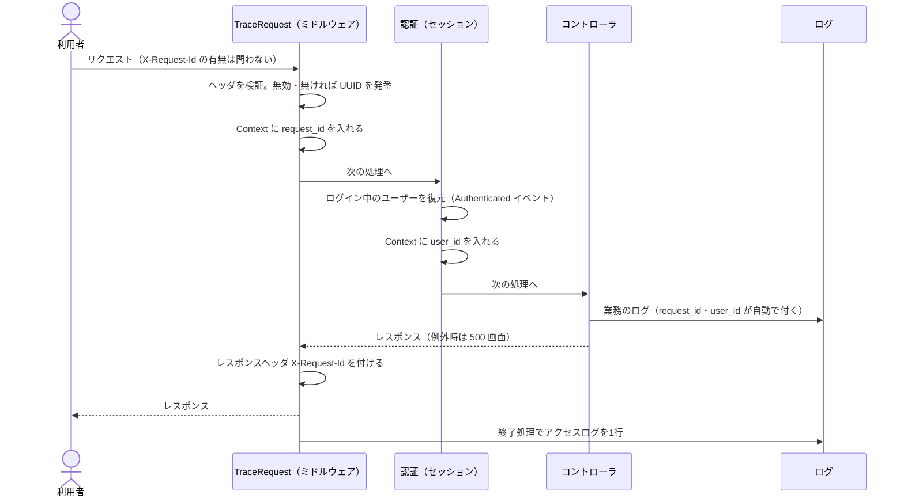
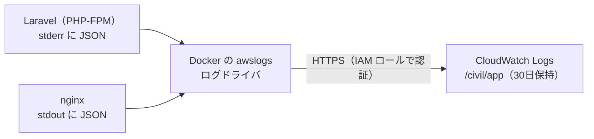

# ログ・監視設計書

本書は「ログをどう出すか」と「出したログをどう使うか（監視・障害対応）」をまとめる。
仕組みの基礎は学習用メモ [logging-monitoring-basics.html](learning/logging-monitoring-basics.html) を参照。

> **本書の範囲。** 1〜6章（アプリ側のログ）と7〜8章（CloudWatch への転送・アラーム）は、
> 2026-10-22 に本番で稼働させた（Issue #107。PR #108・#109）。稼働時の確認結果は 8.4 を参照。

---

## 1. 何のためにログを出すか

障害対応や問い合わせで知りたいことは、次の3つに集約される。

| 問い | 答えるための情報 |
|---|---|
| **何が起きたか** | メッセージ・例外の種類・スタックトレース |
| **誰に起きたか** | ユーザーID（`users.id`） |
| **いつ・どの操作の中で** | 時刻・リクエストID（同じリクエストのログ行を束ねる） |

導入前は、アプリが自分で出すログが 0件で、本番のログもコンテナ内のファイルにしか残らず
再ビルドで消えていた。3つとも答えられない状態だった。

---

## 2. ログレベルの使い分け

| レベル | 判断基準 | 例 |
|---|---|---|
| `ERROR` | **人が対応すべき異常。** サーバー側（インフラ・バグ）が原因 | 想定外の例外（500）、写真の保存失敗、DB エラー |
| `WARNING` | **想定内だが記録しておきたい失敗** | ログイン失敗 |
| `INFO` | **正常な業務上の出来事** | ログイン・ログアウト、パスワード変更、ユーザー管理、案件の削除、写真の保存・削除、アクセスログ |
| `DEBUG` | 開発中の調査用 | 本番では出さない（`LOG_LEVEL=info`） |

**迷いやすい境界**

- **ログイン失敗は WARNING、写真の保存失敗は ERROR。** 前者は利用者の入力ミスという想定内の
  出来事。後者はサーバー側の異常で、人が気づいて対応する必要がある。
- **入力チェックのエラー（必須項目の未入力など）はログに出さない。** 画面で利用者に伝えれば
  足り、調査の役に立たない（Laravel の既定でも `ValidationException` は記録しない）。
- **404・403 はアクセスログの `status` で分かるため、個別のログは出さない。**

---

## 3. ログの形式と出力先

### 3.1 本番：標準エラー出力に JSON 1行

| 設定（`.env.production`） | 値 | 意味 |
|---|---|---|
| `LOG_CHANNEL` | `stderr` | 標準エラー出力に書く。Docker のログドライバが外部へ運ぶ（7章） |
| `LOG_STDERR_FORMATTER` | `Monolog\Formatter\JsonFormatter` | 1行1件の JSON にする |
| `LOG_LEVEL` | `info` | INFO 以上を出す |

例外のスタックトレースも JSON に含める（[config/logging.php](../config/logging.php) の
`stderr` チャンネルで `includeStacktraces`）。Monolog はトレースを「ファイル:行」の形だけで
出し、関数の引数の値は含めないため、引数に入っていた入力値がログに漏れることはない。

**PHP-FPM の設定もあわせて変える**（[docker/php/fpm-logging.conf](../docker/php/fpm-logging.conf)）。
Laravel が stderr に書いたログは PHP-FPM を経由して Docker に渡る。

| 設定 | 値 | 理由 |
|---|---|---|
| `log_limit` | `65536` | 公式イメージの既定（8192文字）では、長い行が途中で2行に分かれ、JSON として読めなくなる（1万文字の行で実測し、8192文字で分割されることを確認） |
| `access.log` | `/dev/null` | PHP-FPM 自身のアクセスログ（`"GET /index.php" 200` だけの行）は、nginx と Laravel のアクセスログと重複するため出さない |

出力例（ローカルで本番と同じ設定にして採取）:

```json
{"message":"写真を保存しました","context":{"case_id":12,"log_id":null,"count":2},"level":200,"level_name":"INFO","channel":"production","datetime":"2026-10-20T20:39:22.144570+09:00","extra":{"request_id":"8cce8924-5864-4b33-9e69-1dc4de02b1d5","user_id":5}}
```

| 項目 | 内容 |
|---|---|
| `message` | 何が起きたか（日本語。アクセスログは `access`） |
| `context` | その出来事に固有の値（案件ID・件数など） |
| `level_name` | ログレベル |
| `extra.request_id` / `extra.user_id` | 全行に自動で付く（4章） |

### 3.2 ローカル：従来どおりファイルに文章形式

`.env.example` は `LOG_CHANNEL=stack`（`storage/logs/laravel.log`）のまま。開発中に JSON が
流れると人には読みにくいため。本番と同じ形式を試す方法は `.env.example` のコメントを参照。

テスト実行中は `phpunit.xml` で `LOG_CHANNEL=null` にし、開発用のログファイルに書かない。

### 3.3 nginx のアクセスログ

[docker/nginx/default.conf](../docker/nginx/default.conf) で独自の形式（`civil_json`）を定義し、
JSON 1行で出す。

```json
{"source":"nginx","time":"2026-10-20T11:36:58+00:00","method":"GET","path":"/login","status":200,"bytes":1671,"duration_s":0.088,"request_id":"a03e290c-0e62-453f-8599-ba33d34da8a3"}
```

- nginx 既定の形式は URL をクエリ文字列ごと記録する（`GET /requests?keyword=...`）。検索語を
  残さないため、**クエリ文字列を除いたパス**だけを出す（6章）
- `request_id` はアプリが返す `X-Request-Id` ヘッダの値。アプリのログと突き合わせられる
- `/health`・`/up`（ALB が30秒ごとに叩く死活確認）は記録しない
- 接続元の IP アドレスは記録しない（9章）

---

## 4. リクエストID とユーザーID



| 実装 | 役割 |
|---|---|
| [TraceRequest.php](../app/Http/Middleware/TraceRequest.php) | リクエストIDの決定、`X-Request-Id` ヘッダ、アクセスログ。全ルート共通（グローバルミドルウェア） |
| [AppServiceProvider.php](../app/Providers/AppServiceProvider.php) | `Authenticated` イベントで `user_id` を Context に入れる |
| Laravel の `Context` | 入れた値を、以降のすべてのログ行の `extra` に自動で付ける |

**外から受け取った ID をそのまま信用しない。** 改行を含む値を送られると、ログに偽の行を書き込まれる
（ログインジェクション）。`X-Request-Id` は英数字とハイフン・64文字以内のときだけ使い、外れる値は
発番し直す。

**ユーザーIDは `users.id`（内部の番号）。** ログインID（`staff101` 等）は出さない。

**エラー画面に表示する。** 500 エラーの画面（[errors/500.blade.php](../resources/views/errors/500.blade.php)）に
「問い合わせ番号」としてリクエストIDを出す。利用者からこの番号を聞けば、その操作のログが揃う（8章）。

### アクセスログ

1リクエスト1行、`message` は `access`。

| 項目 | 内容 |
|---|---|
| `method` / `path` | HTTP メソッドとパス（クエリ文字列なし） |
| `route` | ルート名（`requests.index` 等）。存在しない URL では `null` |
| `status` | ステータスコード |
| `duration_ms` | 処理時間（ミリ秒） |

---

## 5. 記録する業務イベント

| メッセージ | レベル | context | 箇所 |
|---|---|---|---|
| ログインしました | INFO | — | [AuthController](../app/Http/Controllers/AuthController.php) |
| ログインに失敗しました | WARNING | —（入力されたID・パスワードは出さない） | 同上 |
| ログアウトしました | INFO | — | 同上 |
| パスワードを変更しました | INFO | — | [PasswordController](../app/Http/Controllers/PasswordController.php) |
| ユーザーを登録／更新／無効化／再有効化／削除しました | INFO | `target_user_id` | [UserController](../app/Http/Controllers/UserController.php) |
| 初期パスワードを再発行しました | INFO | `target_user_id`（新しいパスワードは出さない） | 同上 |
| 案件を削除しました | INFO | `case_id` | [RequestController](../app/Http/Controllers/RequestController.php) |
| 写真を保存しました | INFO | `case_id` / `log_id` / `count` | [RequestPhotoStore](../app/Support/RequestPhotoStore.php) |
| 写真を削除しました | INFO | `case_id` / `photo_id` | 同上 |
| 写真の保存に失敗しました | ERROR | `case_id` / `log_id` / `disk` / `exception_class` | 同上（例外は投げ直し、例外ハンドラがトレース付きで記録する） |
| データベースの処理に失敗しました | ERROR | `sql`（値は `?` のまま）/ `error_code` / `trace` | [bootstrap/app.php](../bootstrap/app.php)（6章） |

- 「誰が」は `extra.user_id`（操作した本人）で分かる。ユーザー管理は操作した管理者が `user_id`、
  対象が `target_user_id`
- 案件は `case_id`（`requests.id`）で表す。`request_id` はリクエストIDと紛らわしいため使わない
- 案件の登録・更新、対応履歴の追加などは、アクセスログ（`route` と `status`）で足りるため個別には出さない

---

## 6. ログに出してはいけないもの

| 対象 | 理由と対策 |
|---|---|
| **パスワード** | ログを見られる人すべてに漏れる。ログイン失敗でも入力値は出さない。再発行したパスワードは画面にだけ出す |
| **要望者名・要望内容・住所** | 個人に関わる情報（CLAUDE.md 6章）。案件は `case_id` だけで記録する |
| **検索語（クエリ文字列）** | 一覧の検索欄の語句は URL の `?keyword=…` に載る。アプリ・nginx とも、アクセスログはパスだけを出す |
| **写真のファイル名** | 利用者が名前や住所を含む名前を付けることがある。件数だけを出す |
| **署名付きURL・セッション・Cookie** | それ自体が鍵になる。ヘッダやクエリ文字列を記録しないことで防ぐ |
| **DB エラーの SQL に埋め込まれた値** | Laravel 既定では、DB エラーの例外メッセージに SQL と埋め込まれた値（要望者名など）がそのまま入る。`QueryException` だけは独自に記録し、値を `?` のままにした SQL とエラーコード、発生箇所だけを出す |

**テストで機械的に確かめる。** 「気をつける」だけでは守りきれないため、
[LoggingTest](../tests/Feature/LoggingTest.php) で、テスト用のパスワード・要望者名・要望内容・
検索語・ファイル名を使って一連の操作をしたあと、**本番と同じ JSON 形式に整形した全ログ行**に
それらが1つも含まれないことを確かめる。個別のログ文を1つずつ確認する方式だと、新しいログを
足したときに検査の穴が残るため、全行を1か所で見張る形にしている。

守りを外すと実際にテストが失敗することも確認済み（`QueryException` の独自記録を外す、
アクセスログのパスをクエリ文字列付きにする → 3件が失敗）。

---

## 7. CloudWatch への転送



- **アプリは CloudWatch を知らない。** ログを標準出力・標準エラー出力に書くだけで、運ぶのは
  Docker（`docker-compose.prod.yml` の `logging:` 設定）。送り先を変えてもアプリのコードは変わらない
- **EC2 のディスクにログを溜めない**（#102）。既定のログドライバ（json-file）は上限なく溜まる
- 認証は EC2 の IAM ロール（S3 と同じ）。アクセスキーは置かない
- ロググループを本システム専用（`/civil/app`）にし、famigo のログと混ざらないようにする
  （ログストリームは `php`・`nginx`。保持30日）
- `mode: non-blocking`：CloudWatch への送信が詰まっても、アプリのログ書き込みで処理を待たせない
- AWS 側（ロググループ・IAM・アラーム）は Terraform（[infra/monitoring.tf](../infra/monitoring.tf)）で作る。
  構成と理由は [インフラ設計書](infrastructure-design.md) 3.11

**CloudWatch に届かないログ。** `docker compose exec php php artisan ...` で手動実行したコマンド
（`sample:refresh` など）のログは、コンテナ本体（PID 1）の出力ではないため Docker のログドライバを
通らない。実行した画面の表示で確認する。

**Datadog ではなく CloudWatch にした理由。** 無料枠で収まる（月0円の見込み）、専用の常駐
エージェントが要らない（famigo と共用の t3.micro はメモリに余裕が少ない）、API キーを置かずに
IAM ロールで認証できる、の3点。アプリは標準出力に書くだけなので、将来 Datadog に替える場合も
アプリのコードは変えずに済む。

---

## 8. 監視と障害対応

### 8.1 アラーム

通知は SNS（トピック `civil-request-alerts`）でメール。異常になったとき（ALARM）と、戻ったとき（OK）の両方で届く。

| アラーム名 | 見張るもの | 条件 | 気づきたいこと |
|---|---|---|---|
| `civil-request-app-errors` | ログの `level` が 400（ERROR）以上の行数（メトリクスフィルタ `{ $.level >= 400 }` → `CivilTrack/AppErrorCount`） | 5分間に1件以上 | アプリの異常・S3 や DB の障害 |
| `civil-request-site-down` | ALB のターゲットグループ（`civil-request-tg-8081`）の正常なサーバー数（`HealthyHostCount`） | 1未満が2分続く | コンテナや EC2 の停止 |
| `civil-request-disk-usage` | EC2 のディスク使用率（`CivilTrack/DiskUsedPercent`。EC2 の systemd タイマーが5分ごとに送信） | 85% 以上 | 古いイメージやログの蓄積（#102） |

- **EC2 を停止したときも「サイト停止」は鳴る**（停止から約10分後に1通。起動すると OK が1通）。自分で止めたときのメールは対応不要。停止中にほかの2つは鳴らない（値が届かない＝正常扱い）
- **デプロイ直後は「ディスク逼迫」が鳴ることがある。** ビルド直後は新旧のイメージが並んで一時的に90%前後まで上がるため（8.4）。旧イメージの掃除（`docker image prune -a`）で戻る

**何を監視しないか。** 利用状況（ログイン数・登録件数など）はログの目的ではないため対象外。
ログと監視は「壊れていないか」を見るためのもの。

### 8.2 利用者から「エラーが出た」と言われたら

1. エラー画面の **問い合わせ番号（リクエストID）** を聞く。無ければ、おおよその時刻と操作
2. CloudWatch Logs でリクエストIDを検索する → アプリのログと nginx のアクセスログが揃う
3. 同じ `user_id` で前後の操作を見て、何をしようとしていたかを確かめる
4. ERROR 行のメッセージとスタックトレースから原因を探す。再現手順が分かれば Issue にする

### 8.3 よくある事象と一次対応

| 事象 | ログでの見分け方 | 一次対応 |
|---|---|---|
| パスワード違い | `ログインに失敗しました`（WARNING） | 対応不要。同じ時間帯に大量に出ていれば不正なログインの試みを疑う |
| 写真を保存できない | `写真の保存に失敗しました`（ERROR）と直後の例外 | 例外の種類で S3 側（権限・障害）かアプリ側かを切り分ける |
| DB エラー | `データベースの処理に失敗しました`（ERROR） | `error_code` と `sql` から原因を探す（値は出ないため、必要なら画面の操作内容を利用者に聞く） |
| 想定外の 500 | 例外クラス・メッセージ・トレース付きの ERROR | トレースから原因箇所を特定する |

ログの具体的な見方（CloudWatch の画面、Logs Insights の検索例）は [運用手順](operations-start-stop.md)「CloudWatch によるログ・監視」を参照。

### 8.4 稼働時の確認結果（2026-10-22）

| 確認したこと | 結果 |
|---|---|
| `terraform apply` | 8 added, 0 changed, 0 destroyed。EC2 ロールのインラインポリシーは famigo の既存2枚に `CivilTrackLogsAndMetrics` が加わったのみ |
| ログの送り先 | `docker inspect` でコンテナのログドライバが `awslogs` になったこと。`/civil/app` に `php`・`nginx` のストリームができ、ログが届いたこと |
| ログの中身 | 本番で JSON 1行・`channel: production`・`extra` にリクエストIDとユーザーIDが付くこと。一覧を検索しても `path` は `/requests` のみで、検索語が残らないこと |
| `docker compose logs` | awslogs ドライバでも EC2 上で直近のログを見られること（Docker のローカルキャッシュ） |
| ディスク使用率の送信 | systemd タイマーの初回実行が `status=0/SUCCESS`。CloudWatch に値が届いたこと |
| ディスク逼迫アラーム | デプロイ直後に使用率が **90%**（作業前78%）になり、実際に ALARM → メール受信。旧イメージの掃除で78%に戻り OK に復帰 |
| エラー発生アラーム | テスト用の ERROR 行を1行書き、ALARM → メール受信。約5分後に OK に復帰 |
| サイト停止アラーム | 作業後に EC2 を停止（22:15）→ 約10分後（22:25）に ALARM → メール受信。停止中は ALB の数値が届かなくなり、「届かない＝異常」の設定（`treat_missing_data = breaching`）で鳴った |
| メールの届き方 | 状態が変わった瞬間（OK→ALARM、ALARM→OK）に1通ずつ。ALARM が続いている間に繰り返し届くことはない |
| famigo | 作業中も `famigo-api` は停止せず稼働 |

---

## 9. 未対応・今後

| 項目 | 状態 | 補足 |
|---|---|---|
| **接続元 IP アドレスの記録** | 記録しない | 不正なログインの試みを IP 単位で見たくなった場合は、ALB が付ける `X-Forwarded-For` を記録するか判断する（個人に関わる情報になりうるため、保持期間とあわせて決める） |
| **ログレベルの動的変更** | 未対応 | 変えるには `.env.production` を書き換えて再起動する |
| **分散トレーシング** | 対象外 | 1台のサーバーで完結する構成のため不要 |
| **利用状況の分析** | 対象外 | 8.1 を参照 |

---

## 関連ドキュメント

- [インフラ設計書](infrastructure-design.md) — 6.2 本番 `.env`、3.4 ディスク使用量
- [運用手順](operations-start-stop.md) — デプロイ・停止再開
- [学習用メモ：ログと監視の基礎](learning/logging-monitoring-basics.html)
- 参考：SnsTimeLineApp `docs/12_logging_and_operations.md`（同じ考え方を Spring Boot で実装したもの）
